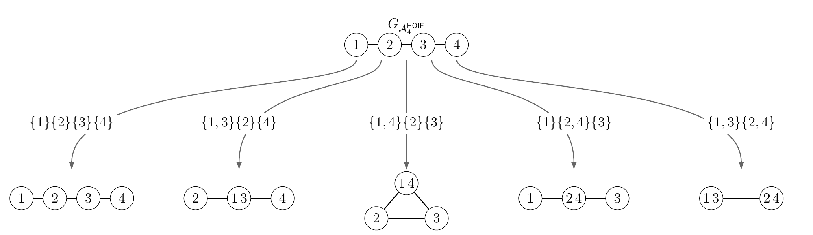
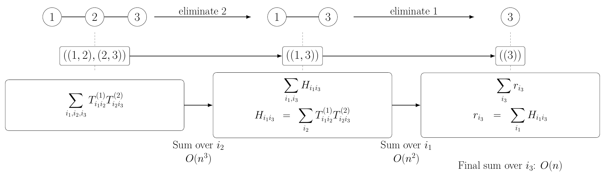

# On computing and the complexity of computing higher-order U-statistics, exactly

**作者**：Xingyu Chen, Lin Liu, Ruiqi Zhang

**来源**：Statistics and Computing 36, Article 223 (2026)

**主题**：高阶 U-统计量的精确计算、张量缩并与商图树宽

**链接**：[期刊页](https://doi.org/10.1007/s11222-026-10974-x) · [arXiv](https://arxiv.org/abs/2508.12627) · [论文与报告资源](https://cxy0714.github.io/en/research/higher-order-u-statistics/)

> 本文于 2026-10-13 依据作者的 poster、`slides_xingyu_261024.tex` 与论文修订稿重新撰写。阅读主线是：有序 U-统计量 → U-to-V 精确展开 → 因子对角置零 → 商图 → 树宽控制缩并成本。关键区别是：**单个 V-统计量看它自己的分解图，U-统计量则要看展开后所有保留项的商图。**

## 一、问题：高阶就一定要枚举所有元组吗？

高阶 U-统计量出现在高阶影响函数（HOIF）、网络 motif 计数和距离协方差等问题中。直接计算一个 m 阶统计量，需要遍历约 $n^m$ 个元组。这个枚举成本很容易让理论上有价值的估计量难以实现。

一条常见路线是使用不完全 U-统计量：只抽取部分元组，减少计算，同时分析额外随机性带来的统计误差。本文研究另一条路线：**保留完整统计量，利用核函数内部的乘法分解结构改变求和顺序，精确计算原来的和。** 这里的“精确”指代数上计算同一个统计量，数值实现仍使用浮点运算。

论文将三个工具连接起来：集合划分上的 Möbius 反演负责处理“所有索引互异”的约束；Einstein 求和将允许索引重复的和写成张量缩并；图的顶点消除与树宽描述缩并顺序的成本。这条路线不要求核函数对称，也不保证每个高阶核都能得到明显加速。

## 二、先统一记号：有序、不要求对称、暂不归一化

对给定数据 $X_1,\ldots,X_n$ 和核 $h:\mathcal X^m\to\mathbb R$，定义

$$
\mathbb U_{n,m}[h]
=\sum_{\substack{(i_1,\ldots,i_m)\in[n]^m\\i_1,\ldots,i_m\ \text{两两不同}}}
 h(X_{i_1},\ldots,X_{i_m}),
\qquad
\mathbb V_{n,m}[h]
=\sum_{(i_1,\ldots,i_m)\in[n]^m}h(X_{i_1},\ldots,X_{i_m}).
$$

这里的核可以不对称，求和使用**有序元组**。若需要通常的平均形式，应将 $\mathbb U_{n,m}[h]$ 除以 $(n)_m=n!/(n-m)!$；相应 V-统计量平均为 $n^{-m}\mathbb V_{n,m}[h]$。对称核的组合平均与有序元组平均相同，但未归一化的两个和相差 $m!$。下文一律讨论未归一化的和，以免展开系数混入归一化常数。

计算恒等式对固定数据成立，不需要独立同分布假设。若样本独立同分布且核可积，才进一步得到 $(n)_m^{-1}\mathbb U_{n,m}[h]$ 对 $\mathbb E h(X_1,\ldots,X_m)$ 的无偏性。

核的乘法分解写作

$$
h(x_1,\ldots,x_m)=\prod_{k=1}^K h_k(x_{A_k}),
\qquad \mathcal A=(A_1,\ldots,A_K).
$$

每个 $A_k$ 是记录因子输入位置及顺序的元组，$\mathcal A$ 称为分解签名。将因子在数据上求值得到张量 $T^{(k)}$，就能用 `einsum` 表达 V-统计量。真正有用的是低元数因子的分解；把整个核当作一个 m 元因子当然也能写成这种形式，却通常没有节省计算。

## 三、贯穿全文的例子：四阶 HOIF 必须算完整的五项

### 1. 链式核与一个容易算的 V-统计量

考虑海报和 slides 使用的四阶 HOIF 型核

$$
h_4(x_1,x_2,x_3,x_4)
=f_1(x_1,x_2)f_2(x_2,x_3)f_3(x_3,x_4),
\qquad \mathcal A=((1,2),(2,3),(3,4)).
$$

其分解图是路径 $1-2-3-4$。记三个因子矩阵为 $T^{(1)},T^{(2)},T^{(3)}$，则

$$
\mathbb V[h_4]=\sum_{i,j,k,l}T^{(1)}_{ij}T^{(2)}_{jk}T^{(3)}_{kl}
=\mathbf 1^\top T^{(1)}T^{(2)}T^{(3)}\mathbf 1.
$$

右端是标量。先求两端的列和、行和，再处理中央矩阵，就可用 $O(n^2)$ 运算完成，无须先形成完整的矩阵乘积。具体地，令 $a_j=\sum_iT^{(1)}_{ij}$、$b_k=\sum_lT^{(3)}_{kl}$，再计算 $\sum_{j,k}a_jT^{(2)}_{jk}b_k$。

**这只算出了一个允许索引重复的 V-统计量，还没有算出四阶 U-统计量。** 后者必须扣除索引碰撞，并补回重复扣除的部分。

### 2. Möbius 反演：从互异索引到集合划分

设 $\Pi_m$ 为 $[m]$ 的所有集合划分。对划分 $\pi$，$\mathbb V[\pi](h)$ 要求同一块内的位置使用相同索引，**不同块的索引仍可相同**。例如

$$
\mathbb V[13|2|4](h_4)=\sum_{i,j,k}T^{(1)}_{ij}T^{(2)}_{ji}T^{(3)}_{ik}.
$$

这里用 $13|2|4$ 简记 $\{\{1,3\},\{2\},\{4\}\}$。精确恒等式为

$$
\mathbb U[h]=\sum_{\pi\in\Pi_m}\mu_\pi\mathbb V[\pi](h),
\qquad
\mu_\pi=(-1)^{m-|\pi|}\prod_{C\in\pi}(|C|-1)!.
$$

四阶共有 Bell 数 $B_4=15$ 个划分。只合并一对位置的系数为 $-1$，两个二元块的系数为 $+1$，三元块的系数为 $+2$，四元块的系数为 $-6$。因此 U-to-V 是有符号的线性组合，不能用原始那一个 V-统计量替代。

### 3. 对角置零：15 项减少为 5 项

对每个二元因子定义

$$
\widetilde T^{(r)}_{ij}=T^{(r)}_{ij}\mathbf1\{i\ne j\},\qquad r=1,2,3.
$$

这不会改变 U-统计量，因为 U 的每个元组本来就具有互异索引。它会改变 V-统计量，但我们将 Möbius 恒等式应用于修改后的核 $\widetilde h_4$，仍然得到原来的 U。

此时，只要一个划分合并了路径上相邻的位置，对应项就包含为零的因子对角元。比如合并 $1,2$ 会出现 $\widetilde T^{(1)}_{ii}=0$。15 项中有 10 项因此恒等于零，剩下

$$
\boxed{
\begin{aligned}
\mathbb U[h_4]
={}&\mathbb V[1|2|3|4](\widetilde h_4)
-\mathbb V[13|2|4](\widetilde h_4)\\
&-\mathbb V[14|2|3](\widetilde h_4)
-\mathbb V[1|24|3](\widetilde h_4)
+\mathbb V[13|24](\widetilde h_4).
\end{aligned}}
$$

令 $A=\widetilde T^{(1)}$、$B=\widetilde T^{(2)}$、$C=\widetilde T^{(3)}$。五项的具体计算如下；每一行中的索引都独立遍历 $[n]$。

| 划分 | 系数 | 对应的 V-统计量 | 商图 | 树宽 | 缩并成本上界 |
| --- | --- | --- | --- | --- | --- |
| $1\vert2\vert3\vert4$ | $+1$ | $\sum_{i,j,k,l}A_{ij}B_{jk}C_{kl}$ | 四顶点路径 | 1 | $O(n^2)$ |
| $13\vert2\vert4$ | $-1$ | $\sum_{i,j,k}A_{ij}B_{ji}C_{ik}$ | 三顶点路径 | 1 | $O(n^2)$ |
| $14\vert2\vert3$ | $-1$ | $\sum_{i,j,k}A_{ij}B_{jk}C_{ki}$ | 三角形 | 2 | $O(n^3)$ |
| $1\vert24\vert3$ | $-1$ | $\sum_{i,j,k}A_{ij}B_{jk}C_{kj}$ | 三顶点路径 | 1 | $O(n^2)$ |
| $13\vert24$ | $+1$ | $\sum_{i,j}A_{ij}B_{ji}C_{ij}$ | 一条边 | 1 | $O(n^2)$ |



例如第二项可以先计算 $\sum_jA_{ij}B_{ji}$ 与 $\sum_kC_{ik}$，再逐 i 相乘求和；第四项同样能用局部求和完成。第三项则是 $\operatorname{tr}(ABC)$，在论文讨论的逐索引消除框架中对应三角形，成本上界为 $O(n^3)$。

所以四阶例子的结论是

$$
\boxed{\text{缩并阶段成本}=O(n^3+4n^2)=O(n^3).}
$$

这个三次项来自**合并首尾位置 $1,4$ 后出现的三角形**。原始 V-统计量的链图树宽是 1，并不能据此断言 U-统计量也是二次复杂度。

### 4. 可直接核对的计算表达式

下面的代码输入原始因子矩阵，返回未归一化的四阶 U-统计量。五个 `einsum` 分别对应上表五行，矩阵不要求对称。

```python
import numpy as np

def hoif4_sum(T1, T2, T3):
    A, B, C = [np.array(T, dtype=float, copy=True) for T in (T1, T2, T3)]
    for T in (A, B, C):
        np.fill_diagonal(T, 0.0)
    return (
        np.einsum('ij,jk,kl->', A, B, C, optimize=True)
        - np.einsum('ij,ji,ik->', A, B, C, optimize=True)
        - np.einsum('ij,jk,ki->', A, B, C, optimize=True)
        - np.einsum('ij,jk,kj->', A, B, C, optimize=True)
        + np.einsum('ij,ji,ij->', A, B, C, optimize=True)
    )
```

若要得到平均形式，再除以 $n(n-1)(n-2)(n-3)$。`optimize=True` 是实现中的路径选择，不等于对任意签名保证达到理论最优树宽。

## 四、一般理论：V 看分解图，U 看商图族

### 1. 分解图与顶点消除

分解图 $G_{\mathcal A}$ 的顶点是核函数的输入位置；只要两个位置在同一因子中共同出现，就连接一条边。因此一个 r 元因子会在其输入位置上生成一个 r 顶点团。

求和消去一个索引后，它涉及的其他索引可能进入同一个中间张量。这对应图上的操作：把该顶点的邻居补成团，再删除该顶点。若消去时有 d 个剩余邻居，常规稠密计算需要处理至多 $n^{d+1}$ 规模的运算，输出中间张量有 $n^d$ 个元素。对所有消除顺序，最小化最大 d，就得到树宽。



因此，论文的张量缩并结果及其 V-统计量推论给出：存在消除顺序，使缩并阶段时间成本满足

$$
O\!\left(Kn^{\operatorname{tw}(G_{\mathcal A})+1}\right).
$$

这是该计算框架下的**存在性上界**。它不是所有精确算法都必须付出的下界；也不是说任意顺序、任意 `einsum` 实现都能自动达到这个成本。

### 2. 为什么合并顶点会让树宽增加？

在 $\mathbb V[\pi](\widetilde h)$ 中，同一划分块的索引被识别为一个索引。其分解图恰好是商图 $G_{\mathcal A}/\pi$：每块成为一个顶点，原来的因子关系诱导块之间的边。

这里的合并可以把**不相邻的顶点**识别起来，并不局限于图 minor 中的边收缩。所以不能套用 minor 的树宽单调性。四阶路径识别首尾后产生三角形，就是最直接的反例。

对角置零后，只需保留每一块都是分解图独立集的划分：

$$
\Pi_m^{\mathcal A}
=\left\{\pi\in\Pi_m:\ \forall Q\in\pi,\ \forall A_k\in\mathcal A,
\ |Q\cap\operatorname{set}(A_k)|<2\right\}.
$$

于是

$$
\mathbb U[h]=\sum_{\pi\in\Pi_m^{\mathcal A}}
\mu_\pi\mathbb V[\pi](\widetilde h).
$$

这也给出了稀疏化的明确适用条件：某块只要含有同一因子的两个输入位置，就使该项归零。“稀疏化”在这里首先指减少展开项数，并不意味着输入矩阵一定是稀疏矩阵。

### 3. U-统计量的复杂度上界究竟说什么？

定义

$$
M=\max_{\pi\in\Pi_m^{\mathcal A}}\operatorname{tw}(G_{\mathcal A}/\pi),
\qquad
N_l=\left|\left\{\pi\in\Pi_m^{\mathcal A}:\operatorname{tw}(G_{\mathcal A}/\pi)=l\right\}\right|.
$$

$N_l$ 统计的是**划分所索引的展开项数**。即使两个划分产生同构的图，也仍是不同项；图同构不保证因子张量或数值相同。

将各项的缩并成本相加，得到论文 U-统计量推论的上界（有边的情形）：

$$
\boxed{O\!\left(K\sum_{l=1}^{M}N_l n^{l+1}\right).}
$$

若还包括树宽为 0 的无边图，应将 $l=0$ 的项纳入，成本为 $O(KN_0n)$。当 m、K 和签名固定、只看 n 增大时，上述缩并上界可简写为 $O(n^{M+1})$；若 m 也增长，不能把 $N_l$ 的增长藏进常数。

由此才能正确解读几个边界情形：

- **原图是树**：只保证原始 V-统计量可按二次成本缩并；U 展开后的商图可能有环、有更高树宽。
- **所有保留商图的树宽都至多 1**：固定签名时，U 的缩并阶段才得到 $O(n^2)$ 上界。
- **原图是完全图 $K_m$**：每个含两个位置的块都会被稀疏化排除，只剩全单点划分。此时该框架给出 $O(n^m)$ 上界，未改进暴力枚举的 n 指数。这不构成对其他精确算法的普遍下界。

四阶 HOIF 中 $M=2$、$N_1=4$、$N_2=1$，代入一般公式得到 $O(3(n^3+4n^2))$，与上面的逐项分析一致。

## 五、HOIF 的阶数结论：最大商图树宽是分段的

对论文考察的链式 HOIF 核，

$$
\mathcal A_m=((1,2),(2,3),\ldots,(m-1,m)),
\qquad
M(m)=\max_{\pi\in\Pi_m^{\mathcal A_m}}
\operatorname{tw}(G_{\mathcal A_m}/\pi).
$$

原始分解图对每个 $m\ge2$ 都是一条路径，树宽始终为 1。论文 HOIF 的 Observation 刻画的是上式的**最大商图树宽**，对 $m=2,\ldots,12$ 得到以下确切分段值，并在附录给出论证：

| HOIF 阶数 m | 最大商图树宽 $M(m)$ | 固定 m 下的缩并时间上界 | 与直接枚举比较 |
| --- | --- | --- | --- |
| 2、3 | 1 | $O(n^2)$ | 二阶同阶；三阶由 $n^3$ 降至 $n^2$ |
| 4、5、6、7 | 2 | $O(n^3)$ | 由 $n^m$ 降至 $n^3$ |
| 8、9、10 | 3 | $O(n^4)$ | 由 $n^m$ 降至 $n^4$ |
| 11、12 | 4 | $O(n^5)$ | 由 $n^m$ 降至 $n^5$ |

所以七阶 HOIF 的缩并上界是三次，八阶升至四次；不能写成 $M(m)=\lfloor m/2\rfloor$，也不能把“路径树宽为 1”解释为所有阶数都二次。这个表同样不提供 $m>12$ 的通式。

相关的另一项图论 Observation 研究的是：**给定边数 e，所有这类图的最大可能树宽是多少？** 对链式 HOIF，每个商图至多有 $m-1$ 条边，这给出一个可用上界，但还要检查该图能否实际由路径划分得到。例如 $m=7$ 时，单凭六条边可容许树宽为 3 的 $K_4$；论文进一步排除了七顶点路径产生该商图的可能性，才得到 $M(7)=2$。两个 Observation 分别处理边数约束与 HOIF 商图族，不能混为“路径本身的树宽公式”。

## 六、算法落地时还要计算什么？

完整流程是：提供核分解、构建因子张量、将因子内部重复索引位置置零、枚举保留划分、构造诱导签名、逐项缩并并按 Möbius 系数相加，最后按需要归一化。若核是多个乘积项的和，则利用线性性分别处理各个乘积项。

树宽公式描述的是缩并阶段。设 $m_{\max}=\max_k|A_k|$，若一次因子求值成本视为常数，构建张量另有 $O(Kn^{m_{\max}})$ 成本；若因子涉及随 n 增长的特征维数、投影矩阵或其他预处理，必须另计。划分生成、诱导签名构造和缩并路径搜索也有结构处理成本。固定低阶核时可复用这些结果，但随 m 增长时不能忽略。

论文给出的理想峰值空间量级为

$$
O\!\left(\max\{Kn^{m_{\max}},n^M\}\right),
$$

其中各个 V-统计量依次求值、复用工作内存。这依赖于合适的消除顺序；实际后端的临时内存和并行开销可能更高。HOIF 因子是矩阵，当 $M=2$ 时理想空间仍为 $O(n^2)$，当 $M=3$ 时中间张量可能达到 $O(n^3)$。

找到最优消除顺序本身是困难的图算法问题。论文将理论界称为乐观估计，实践中通过 `opt_einsum` 等工具选择路径。固定结构下的路径搜索成本与样本量 n 下的缩并成本是两个层次；启发式路径可能产生更大的中间张量。论文 m=10 的实验中，`dp` 达到宽度 3，而 `greedy` 达到宽度 4，说明路径选择会实质改变运算和内存需求。

## 七、三个应用展示了什么，也没有展示什么？

**HOIF：高阶估计量可以有可行的完整计算。** 海报列出的七阶、$n=10000$ 实验，CPU 为 288.897 秒，GPU 为 8.589 秒；六阶相应为 62.540 秒和 1.665 秒。这些是指定硬件上的十次运行均值，排除了核求值和张量化成本；海报使用 Xeon 8358 与 RTX 5090。不同版本 slides 的硬件及表格不应混用。实验支持该链式核的计算可行性，不代表任意七阶核都有同样成本。

**Motif 计数：通用稠密张量计算与专用稀疏算法各有适用输入。** 海报中 $n=10000$、边概率 $p=0.001$ 时，cuGraph 用时 0.1536 秒，`u-stats` 用时 2.8014 秒；$p=0.1$ 时分别为 10.3661 秒和 7.2829 秒；$p=0.8$ 时该配置下 cuGraph 内存溢出，`u-stats` 仍完成。这个结果反映图密度和实现方式的重要性，不能外推为一个包在所有图上都更快或永不溢出。

**距离协方差：完整计算可以与减少元组数的算法竞争。** 海报的 $n=138$ 点估计实验中，精确实现单进程约 4.0928 秒，并行约 0.1847 秒；对比 MATLAB 完整计算为 3395.4001 秒，不完全计算在 $\alpha=1.5$ 时为 0.4211 秒。核的不同乘积项应分别分析；这个例子可利用树宽至多 1 的相关图得到二次成本。它展示了结构加速的价值，但运行时间差也包含实现、语言和并行方式的差别，不能单凭一组基准断言精确算法总优于不完全 U-统计量。

软件实现：[Python / u-stats](https://github.com/zrq1706/U-Statistics-Python) · [R / ustats](https://github.com/cxy0714/U-Statistics-R)。

## 八、这篇论文留下的研究问题

论文自然导向两个图论问题：对给定分解签名，保留商图族的最大树宽是多少？各个树宽对应多少个划分项？前者控制固定阶数下上界的 n 指数，后者影响实际工作量及阶数增长时的成本。HOIF 的分段结果展示了这两个问题比“原图是否为树”更有信息。

进一步可以研究更高阶 HOIF 的商图结构、消除顺序的时间与空间权衡，以及跨展开项复用中间计算。低秩、稀疏性或特殊代数结构也可能让某些核突破这里的通用缩并成本，因此一般精确算法的下界仍需独立分析。

这些是由本文框架引出的研究方向，不应未经额外文献核对就宣称全部是尚无人解决的缺口。相反，对角置零的保留条件已经在论文中明确刻画，不能再把“稀疏化何时成立”列为本文没有解释的问题。

## 九、阅读时应保留的核心判断

本文提供了一个可执行的精确计算框架：用 Möbius 反演把互异索引约束改写为多个张量缩并，再用商图结构分析各项成本。对于一个具体统计量，先写出分解签名，再列出稀疏化后的商图，最后讨论树宽、项数和内存，才是完整的复杂度分析。

四阶 HOIF 是最清楚的示范：**一个二次成本的链式 V-统计量，加上四个索引碰撞修正项，其中三角形项给出三次成本上界。** 七阶仍可保持三次，上升到八阶后出现四次成本；这些结论来自保留商图族，而不是原始路径图的树宽。

---

**核对依据**：作者项目 `Overleaf_Algorithmic-U-stats` 中的 `poster.tex`、`slides_xingyu_261024.tex`，以及 `minor_re_Statistics_and_computing_submission/ustats_revision_v2.tex` 的 U-to-V 展开、稀疏化引理、U-统计量复杂度推论和 HOIF 附录。两张图沿用作者海报及 slides 的原图。在线论文入口见[期刊页](https://doi.org/10.1007/s11222-026-10974-x)，相关报告见[作者资源页](https://cxy0714.github.io/en/research/higher-order-u-statistics/)。

Maintained by 陈星宇 · [Homepage](https://cxy0714.github.io/) · [Source on GitHub](https://github.com/cxy0714/research-news)
